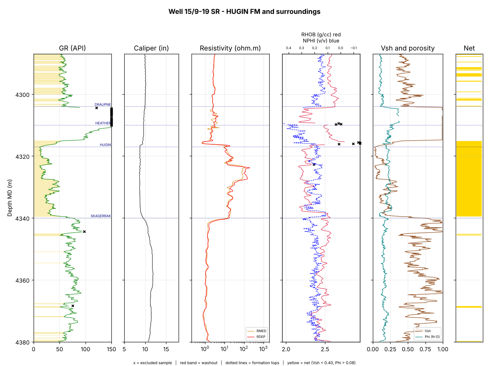

# Wireline log QC and formation evaluation: Volve well 15/9-19 SR

Quality control and a basic petrophysical evaluation of a real wireline log from the Volve field
(Norwegian North Sea). The script checks the raw log for bad data, works out shale volume and porosity for
each formation, and writes a log plot and a PDF report. I also added a pre-job checklist and an HSE risk
register to cover the field-operations side of a wireline job.



## Results

Logged interval used: 3568-4630 m MD (all of GR, density, neutron and resistivity present), 6966 samples
at 0.1524 m.

**Data quality**
- About 2 % of the interval is washed out (caliper well above the local gauge), mostly in the Lista Formation.
  Density and neutron are excluded there.
- About 2.7 % of the main-curve samples were out of range, almost all neutron readings above 60 % in the
  Lista, Heimdal and Draupne/Heather sections.
- Overall status: accept with flags. Tool calibration records and a repeat section are not in the LAS file, so
  the log cannot be fully accepted without them.

**Hugin Formation (4317-4340 m), the reservoir**

| Net rock | Mean Vsh | Mean porosity | Median deep resistivity |
|---|---|---|---|
| 22.6 m of 23 m | 0.15 | 0.21 | about 20 ohm.m |

Clean, porous sand with resistivity well above the shales around it, which is what a hydrocarbon-bearing
reservoir looks like. This is an indicator only. I did not compute water saturation (no reliable Rw), so I
make no pay claim. Full per-formation numbers are in `output/formation_summary.csv`.

## How it works

1. **Load** the LAS file with `lasio`, map curve names (`DEN` to RHOB, `NEU` to NPHI, `RDEP` to RT), convert
   neutron from % to v/v and pick the longest interval where all main curves exist.
2. **QC**: nulls, physical-range limits, narrow spikes (rolling median with a noise floor; resistivity is
   tested in log space), depth-step regularity and caliper washout.
3. **Evaluate**: shale volume from gamma ray (Larionov, older rocks), density porosity, neutron-density
   porosity, net rock (Vsh < 0.40 and porosity > 0.08) and a resistivity indicator (> 10 ohm.m).
   Details and formulas are in [`docs/methods.md`](docs/methods.md).
4. **Report**: two log plots, CSV tables and a 6-page PDF (`output/wireline_qc_report.pdf`).

## Run it

```bash
pip install -r requirements.txt
python3 run.py                 # uses the Volve log in data/raw/
python3 -m pytest              # optional, needs: pip install -r requirements-dev.txt
```

Everything is written to `output/`. The result files from my run are committed so you can look at them
without running anything.

## Repository layout

```
run.py                  entry point
wireline_qc/            config, loaders, qc, evaluation, checks, plots, report, pipeline
tests/                  unit tests for the QC and evaluation functions
data/raw/               Volve LAS log and formation tops
data/*.csv              checklist and HSE register (illustrative templates)
docs/methods.md         formulas, assumptions and cutoffs
output/                 plots, CSV tables and the PDF report
```

## Limitations

- No water saturation, core calibration or fluid data. "Net" is a rock-quality flag, not net pay.
- The LAS header does not say which matrix the neutron tool was scaled to, so I treat it as v/v.
- Washout is judged against a rolling-median gauge, not the actual bit size.
- Cutoffs and baselines are simple choices that a real study would calibrate against core.
- The pre-job checklist and HSE register are templates I wrote as a worked example. They are not records of the
  real Volve job.

## Data and licence

Well-log data: Equinor Volve data set, well 15/9-19 SR, obtained from the public repository
`andymcdgeo/Petrophysics-Python-Series`. The data is under the Equinor Open Data Licence; see
[`data/DATA_SOURCE.md`](data/DATA_SOURCE.md). The code is MIT licensed (see `LICENSE`). This is an independent
learning project and is not endorsed by Equinor.
